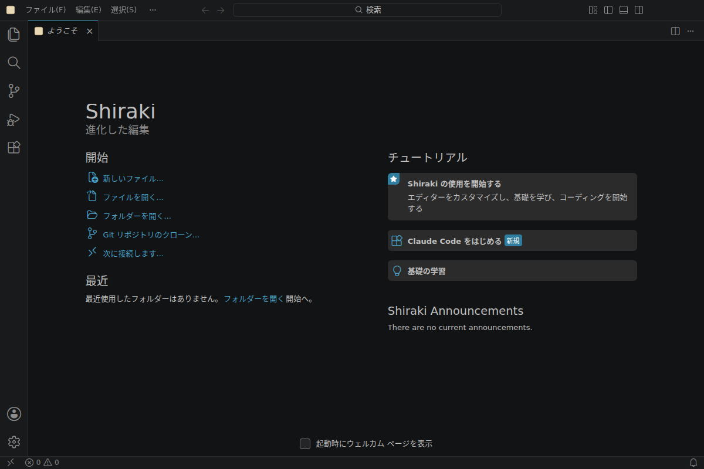

# Shiraki（白木）

[日本語](#日本語) | [English](#english)

## 日本語

### Shiraki とは

白木（しらき）は、鉋をかけたあとの、塗装も飾りもない素の木のことです。Shiraki は、VS Code のオープンソース部分（Code - OSS）から不要なものを削ぎ落としたエディタです。名前には、削ったあとに残る素の状態という意味を込めています。

ビルドの仕組みは [VSCodium](https://github.com/VSCodium/vscodium) をもとにしています。

### 特徴

- AI は Claude Code 拡張機能だけを使う前提です。組み込みのチャットや Copilot 関連の機能は表示されません。
- 組み込み拡張機能を約半分（94 個から 47 個）に減らしました。
- 日本語の UI が標準です。
- テレメトリと実験機能は無効です。Shiraki が行う通信と、止めた通信の一覧は [docs/network.md](docs/network.md) にあります。
- 拡張機能のストアは [Open VSX](https://open-vsx.org/) です。
- [Open Remote - SSH](https://github.com/jeanp413/open-remote-ssh) を同梱しています。リモート側のサーバーは、このリポジトリの Releases からダウンロードされます。
- 起動時に Welcome やおすすめの通知などが出ないように、既定の設定を調整しています。

### 削ったもの・残したもの

- 削ったもの: AI 用のプロンプトの文法、Microsoft アカウント、トンネル、ノートブック、古いタスクランナー（Grunt、Gulp、Jake）、追加の配色テーマ、WordPress や Web 開発で使わない言語の文法など
- 残したもの: PHP、JavaScript / TypeScript、HTML / CSS、Markdown（Mermaid の図を含む）、Git / GitHub、JSON、YAML、Docker など
- 止めた機能: Agents ウィンドウ、GitHub Copilot の管理設定ファイルの監視、`~/.cache/Microsoft` への端末 ID の保存、自動更新（配布の仕組みができるまで）

全一覧と既定の設定は [docs/removed-and-kept.md](docs/removed-and-kept.md) にあります。

### スクリーンショット



### インストール

現在は Linux x64 版だけです。[Releases](https://github.com/moriyama-dev/shiraki/releases) から .deb をダウンロードし、SHA-256 を確かめてからインストールしてください。`VERSION` には、Releases に載っているバージョンを入れてください。

```bash
VERSION=1.135.06820
curl -fLO "https://github.com/moriyama-dev/shiraki/releases/download/${VERSION}/shiraki_${VERSION}_amd64.deb"
curl -fLO "https://github.com/moriyama-dev/shiraki/releases/download/${VERSION}/shiraki_${VERSION}_amd64.deb.sha256"
sha256sum -c "shiraki_${VERSION}_amd64.deb.sha256"
sudo apt install "./shiraki_${VERSION}_amd64.deb"
```

- 日本語フォントがない環境では、推奨パッケージとして `fonts-noto-cjk` も一緒に入ります。
- 自動更新は準備中です。新しい版は、同じ手順で入れ直してください。
- 展開してそのまま使える tar.gz 版もあります。

### 使い方の注意

- 初めて起動したときだけ英語で表示されます。もう一度起動すると日本語になります。
- Claude Code は同梱していません。ヘルプメニューの「ようこそ」を開き、「Claude Code をはじめる」の案内からインストールしてください。

### 自分でビルドする

手順は [docs/howto-build.md](docs/howto-build.md) にあります。CPU 8 コア、メモリ 16GiB の環境で測った目安は次のとおりです。

| 項目 | 目安 |
|---|---|
| フルビルドの時間 | 約 9 分 |
| メモリの最大使用量 | 約 7.7GiB |
| ディスク使用量 | 約 12GB |

不具合の報告や要望は [Issues](https://github.com/moriyama-dev/shiraki/issues) へお願いします。

### クレジットとライセンス

Shiraki は次のプロジェクトの上に成り立っています。

- [VSCodium](https://github.com/VSCodium/vscodium): ビルドスクリプト、パッチ、パッケージングの仕組みをフォークして使っています（MIT ライセンス）。
- [Code - OSS（microsoft/vscode）](https://github.com/microsoft/vscode): エディタ本体のソースコードです（MIT ライセンス）。
- [日本語言語パック（microsoft/vscode-loc）](https://github.com/microsoft/vscode-loc): Open VSX から取得して同梱しています（MIT ライセンス）。訳語の「VS Code」は、製品名を指すものだけ「Shiraki」に置き換えています。

Shiraki は Microsoft および VSCodium プロジェクトとは関係のない、独立したプロジェクトです。「Visual Studio Code」「VS Code」は Microsoft Corporation の商標です。

Shiraki のライセンスは [MIT](LICENSE) です。

## English

### What is Shiraki

*Shiraki* (白木) is the Japanese word for bare wood that has been planed but left unpainted and undecorated. Shiraki is an editor made by removing what is not needed from the open source part of VS Code (Code - OSS). The name refers to what is left after that trimming.

The build system is based on [VSCodium](https://github.com/VSCodium/vscodium).

### Features

- The only AI it is meant to be used with is the Claude Code extension. The built-in chat and Copilot related features are hidden.
- About half of the built-in extensions were removed (from 94 to 47).
- The user interface is in Japanese by default.
- Telemetry and experiments are disabled. The network requests Shiraki makes, and the ones it no longer makes, are listed in [docs/network.md](docs/network.md).
- Extensions come from [Open VSX](https://open-vsx.org/).
- [Open Remote - SSH](https://github.com/jeanp413/open-remote-ssh) is bundled. The remote server is downloaded from the Releases of this repository.
- The default settings are adjusted so that no Welcome page or recommendation notifications appear at startup.

### What was removed and what was kept

- Removed: the AI prompt grammar, Microsoft accounts, tunnels, notebooks, legacy task runners (Grunt, Gulp, Jake), extra color themes, and grammars for languages not used for WordPress or web development
- Kept: PHP, JavaScript / TypeScript, HTML / CSS, Markdown (including Mermaid diagrams), Git / GitHub, JSON, YAML, Docker and more
- Disabled: the Agents window, watching the GitHub Copilot managed settings file, storing a device id in `~/.cache/Microsoft`, and automatic updates (until Shiraki has its own distribution)

The full lists and the default settings are in [docs/removed-and-kept.md](docs/removed-and-kept.md).

### Screenshot


### Installation

Only Linux x64 is available for now. Download the .deb from [Releases](https://github.com/moriyama-dev/shiraki/releases), check its SHA-256 and install it. Set `VERSION` to a version listed in Releases.

```bash
VERSION=1.135.06820
curl -fLO "https://github.com/moriyama-dev/shiraki/releases/download/${VERSION}/shiraki_${VERSION}_amd64.deb"
curl -fLO "https://github.com/moriyama-dev/shiraki/releases/download/${VERSION}/shiraki_${VERSION}_amd64.deb.sha256"
sha256sum -c "shiraki_${VERSION}_amd64.deb.sha256"
sudo apt install "./shiraki_${VERSION}_amd64.deb"
```

- On systems without Japanese fonts, `fonts-noto-cjk` is installed as a recommended package.
- Automatic updates are being prepared. Install newer versions again with the same steps.
- A tar.gz archive that can be used after extracting is also available.

### Notes on use

- The user interface is shown in English only on the very first launch. It switches to Japanese from the next launch.
- Claude Code is not bundled. Open Help > Welcome and install it from the "Get started with Claude Code" guide.

### Building it yourself

See [docs/howto-build.md](docs/howto-build.md). Measured on a machine with 8 CPU cores and 16 GiB of memory:

| Item | Approximate value |
|---|---|
| Full build time | about 9 minutes |
| Peak memory use | about 7.7 GiB |
| Disk use | about 12 GB |

Please report bugs and send requests through [Issues](https://github.com/moriyama-dev/shiraki/issues).

### Credits and license

Shiraki is built on these projects:

- [VSCodium](https://github.com/VSCodium/vscodium): its build scripts, patches and packaging are forked and used here (MIT License).
- [Code - OSS (microsoft/vscode)](https://github.com/microsoft/vscode): the editor source code (MIT License).
- [Japanese language pack (microsoft/vscode-loc)](https://github.com/microsoft/vscode-loc): downloaded from Open VSX and bundled (MIT License). "VS Code" in its translations is replaced with "Shiraki" only where it refers to the product.

Shiraki is an independent project and is not affiliated with Microsoft or the VSCodium project. "Visual Studio Code" and "VS Code" are trademarks of Microsoft Corporation.

Shiraki is licensed under the [MIT License](LICENSE).
